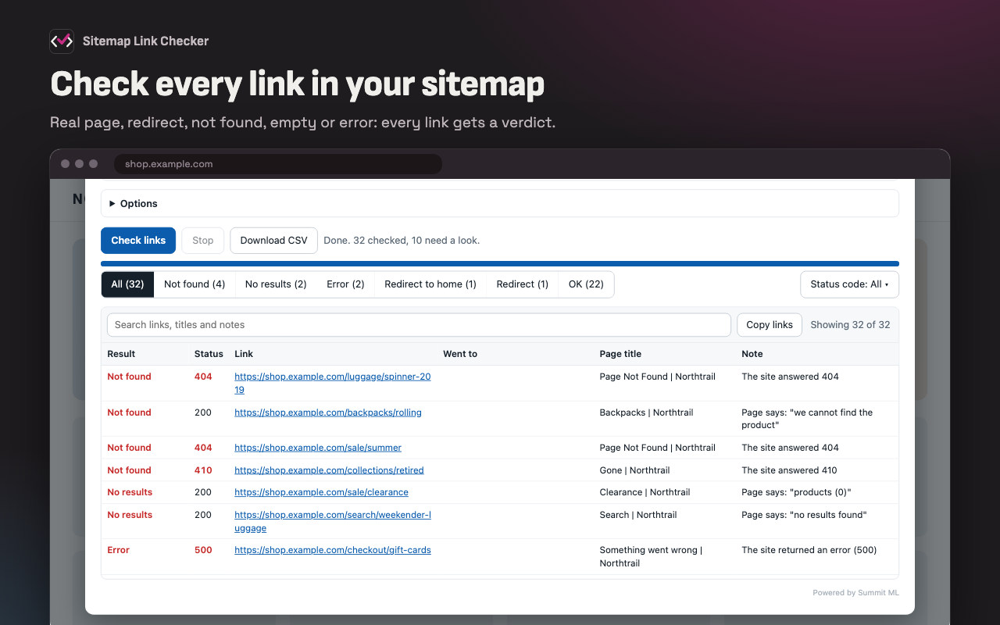
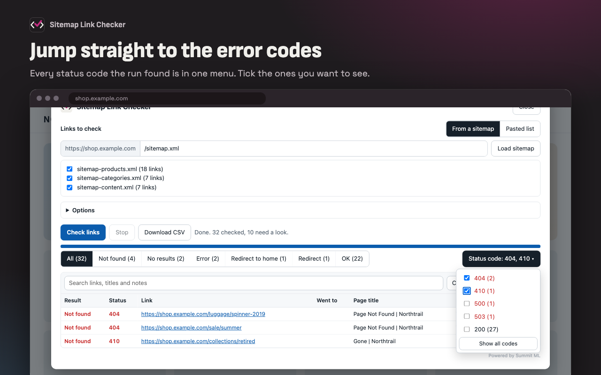
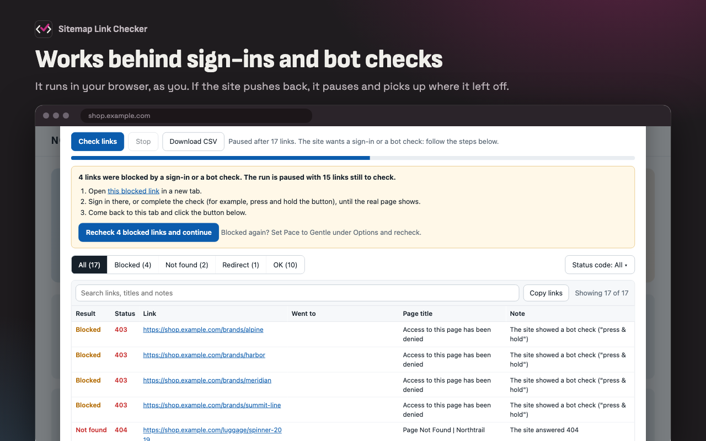
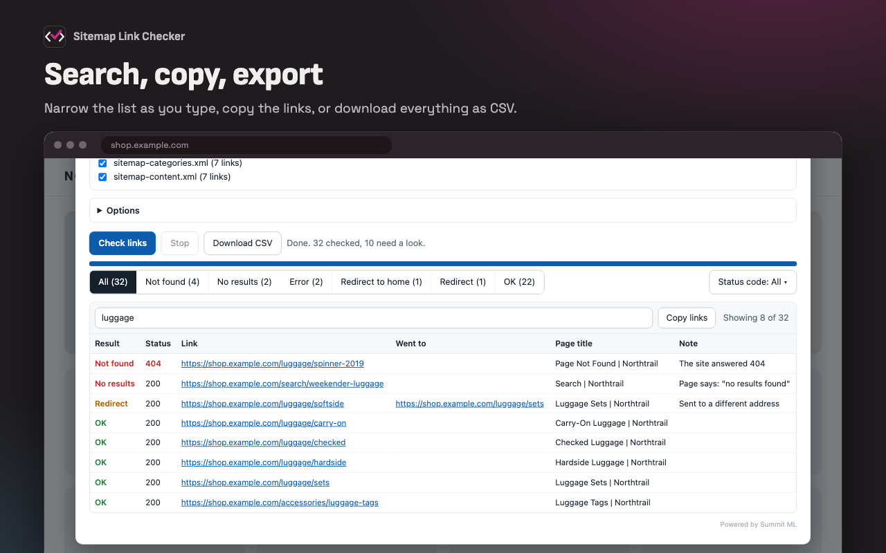
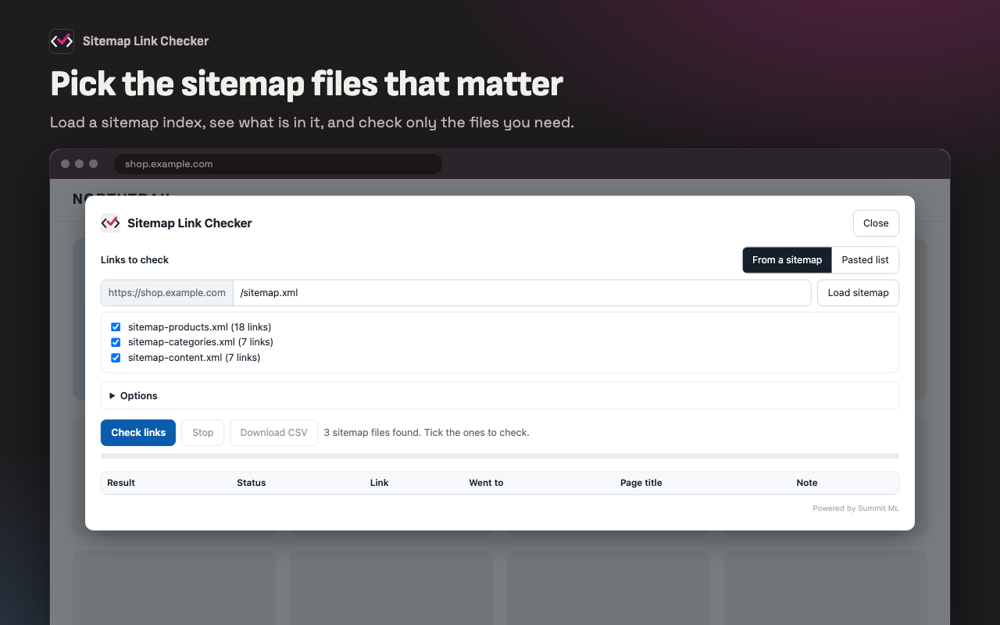

<p align="center"></p>

# Sitemap Link Checker

A browser extension that checks every link in a sitemap and tells you which ones open a real page, which redirect, and which land on a not-found, empty or error page.



It runs inside your browser, on the site you are testing. That means it works on sites a command-line crawler cannot reach: staging sites behind a password, sites behind bot protection, anything you have to be signed in to see.

Nothing is sent anywhere. The extension has no server, no analytics and no standing access to any site.

## Install

The extension is not in the browser stores yet. To load it from this repository:

1. Download or clone this repository.
2. Open `chrome://extensions` (Chrome) or `edge://extensions` (Edge).
3. Turn on **Developer mode**.
4. Click **Load unpacked** and choose the `extension` folder.

Prefer not to install anything? Open `bookmarklet/index.html` in your browser and follow the two steps there. It is the same checker as a bookmark.

## Use

1. Open the site you want to test. Any page will do.
2. Click the **Sitemap Link Checker** button in the toolbar. A panel opens over the page.
3. The sitemap address shows the site you are on, which cannot be changed, followed by the path `/sitemap.xml`. Change the path if your sitemap lives elsewhere, then click **Load sitemap**. If there is no `/sitemap.xml`, the checker tries `/sitemap_index.xml` before giving up.
4. Tick the sitemap files to check and click **Check links**.
5. Filter the results to the problems, and click **Download CSV** to save them.

Three filters sit above the results and work together:

- **Result** buttons: Not found, No results, Error and so on, each with a count.
- **Status code** menu, at the end of the same row: lists every HTTP status the run came across (404, 500, 403 and so on) with a count, error codes first and in red. Tick one or several. The closed menu shows what is chosen, for example "Status code: 404, 500". Links that never loaded, or were skipped, are under **No code**.
- **Search**: narrows the list to links whose address, title or note contains the text you type.

**Copy links** copies the links currently shown, one per line. **Download CSV** always saves the full run.

To check a list of your own instead, switch **Links to check** to **Pasted list** and paste the links, one per line.

**Options**, under the links, holds the pace and the messages that mark a broken page.

## Screenshots

| | |
|---|---|
|  |  |
| Every status code the run found is in one menu. | A sign-in or bot check pauses the run; recheck when you are through. |
|  |  |
| Search the results, copy the links, or download the CSV. | Check only the sitemap files you need. |

The images are made from a real run against a small made-up store. `npm run store` renders them again.

## Results

| Result | Meaning |
|---|---|
| OK | The link opened a normal page. |
| Redirect | The link sent the browser to a different address. The final address is shown. |
| Redirect to home | The link sent the browser to the home page, which usually means the page no longer exists. |
| Blocked | The site showed a bot check, or answered 403 or 429. See below. |
| Sign-in needed | The site answered 401, or sent the browser to a sign-in page. See below. |
| Not found | The site answered 404 or 410, the page shows a not-found message, its title says so, or it is the same page the site shows for an address that does not exist. |
| No results | The link opened a search or category page that lists nothing. |
| Error | The site returned an error, the page shows an error message or has an error title, or the link could not be loaded. |
| Warning | The page loaded, but something says it should not be in the sitemap as it stands. See below. |
| Skipped | The link points to a different site. See the limits below. |

Each row also shows the HTTP status, the page title and the reason for the result.

### Sites behind a sign-in or a bot check

The checker uses your browser's session, so it sees what you see. It never asks for a password and never stores one. Before you run it, sign in, enter the site password, or complete the bot check ("press and hold", a captcha) in the same browser.

If the site blocks links during a run, they are reported as **Blocked** or **Sign-in needed**, and a notice above the results tells you what to do:

1. Open the blocked link from the notice in a new tab.
2. Sign in, or complete the check, until the real page shows.
3. Go back to the tab with the checker and click **Recheck blocked links**.

Only the blocked links are checked again; the other results are kept. After three blocked links in a row the run pauses by itself, so the site is not hit with requests it will only refuse. The recheck button then also carries on with the links that were left.

If the site blocks you again, set **Pace** to **Gentle** under **Options**. It checks one link at a time with a short wait between links, which bot protection is less likely to object to.

### Checks that work on any kind of site

These need no setup and do not depend on the wording a site uses.

- **The site's own not-found page.** Before a run, the checker asks the site for one address that cannot exist. If the site answers `200 OK` for it, the checker remembers that page's title, heading and length, and reports any link that returns the same page as **Not found**.
- **Title and heading.** A title or main heading containing "404", "not found", "doesn't exist", "no longer available" and the like is **Not found**. One that starts with "Error" or "Oops", or says "something went wrong" or "server error", is **Error**.

A page that passes those can still get a **Warning**, with the reason in the Note column:

- **Marked noindex**, in a robots meta tag or the `X-Robots-Tag` header. A page search engines are told to skip does not belong in a sitemap.
- **Canonical points elsewhere.** The page names a different path as its canonical address, so the sitemap lists an address the site itself says is not the real one. A canonical on another host with the same path is not reported, since staging sites often point at production.
- **No title and no main heading.**
- **Almost no text.** Fewer than 150 characters of visible text. On a site drawn by scripts this can mean the checker cannot see the page, not that the page is empty.

Warnings are not given to redirects or to files that are not web pages, such as PDFs. The canonical address is included in the CSV.

### Pages that load but say "not found"

Many sites answer `200 OK` for a page that only says "we can't find that". The checker catches these by looking for phrases in the page's visible text. The list is in the panel under **Options**, as **Messages that mark a broken page**, one phrase per line:

- a phrase containing `no results` or `(0)` reports the page as **No results**
- a phrase containing `error` reports it as **Error**
- any other phrase reports it as **Not found**

If the checker misses a page on your site, copy the wording from that page into the list and run again. Text inside scripts, styles, templates and comments is ignored.

## Limits

- **One site at a time.** A browser only lets a page read responses from its own site. Run the checker on the site the sitemap belongs to. Links to other sites are listed as Skipped.
- **Redirect type is not reported.** The browser follows redirects itself, so the checker sees that a redirect happened and where it ended, not whether it was a 301 or a 302.
- **Scripted pages.** The checker reads the HTML the server returns. Content that only appears after scripts run is not seen.
- **Pace.** Three links are checked at a time, or one at a time with the Gentle pace.
- **Bot checks are recognized by their wording and markup.** A check the tool does not know looks like an ordinary page. When that happens, the Page title column usually gives it away.

## Permissions

| Permission | Why |
|---|---|
| `activeTab` | Lets the extension open its panel on the tab you click the button on, for that click only. |
| `scripting` | Used to place the panel's script into that tab. |

The extension asks for no host permissions and cannot see any page you have not clicked the button on.

## Develop

```
npm test         # unit tests for the classification rules (Node 18 or newer, no dependencies)
npm run build    # rebuilds bookmarklet/index.html from extension/checker.js
npm run icons    # renders the icons from tools/icon.svg (needs rsvg-convert)
npm run store    # renders the store listing images into store/ (needs Google Chrome)
```

- `extension/checker.js` is the whole checker: sitemap loading, link checking, the panel. The decision about each link is one pure function, `classify`, covered by `test/classify.test.js`.
- `extension/background.js` opens the checker when the toolbar button is clicked.
- `tools/icon.svg` is the logo. The extension icons are rendered from it.
- `store/` holds the store listing images, rendered by `tools/store-images/`. `logos/` holds the logo explorations.
- `bookmarklet/index.html` is generated. Edit `tools/bookmarklet.template.html` and run the build.

After changing `checker.js`, run `npm test` and `npm run build`, then reload the extension on the extensions page.

## License

MIT. See [LICENSE](LICENSE).
